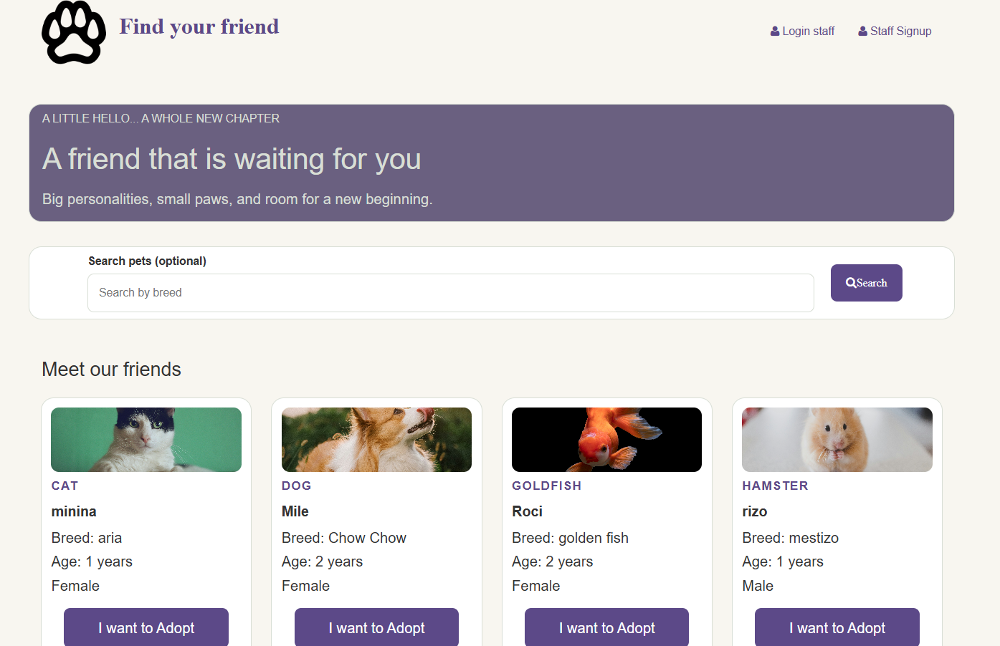

# Find Your Friend 🐾
 
Pet adoption management app. Registered users can log in and manage the list of pets available for adoption: add new pets, edit their information, and remove them.



 
## Features
 
- User authentication with token-based sessions
- Profile page with a table of all pets
- **Create** pets from a form
- **Edit** pets through a dialog pre-filled with the current data
- **Delete** pets with a confirmation prompt
- Data validation on the server (allowed pet types, age range, required fields)
- Pet "adopt" status tracked for each pet
## Tech stack
 
- **Backend:** Node.js, Express (ES Modules)
- **Database:** MongoDB with Mongoose
- **Auth:** token verification middleware (`verificarToken`)
- **Views:** EJS
- **Frontend:** HTML, CSS, vanilla JavaScript, Bootstrap 3, Font Awesome 4

## Getting started
 
### Prerequisites
 
- Node.js 18 or later
- A MongoDB database (local or MongoDB Atlas)
### Installation
 
```bash
git clone https://github.com/YOUR_USERNAME/YOUR_REPO.git
cd YOUR_REPO
npm install
```
 
### Environment variables
 
Create a `.env` file in the project root. Use the same variable names your code reads; these are examples:
 
```
PORT=3000
MONGO_URI=your_mongodb_connection_string
JWT_SECRET=a_long_random_string
```
 
Never commit the `.env` file. Make sure it is listed in `.gitignore`.
 
### Run
 
```bash
node app.js
```
## What I learned
 
- Structuring an Express app with routes, controllers, models and schemas
- Building CRUD operations with Mongoose
- Protecting routes with token-based middleware
- Connecting a frontend to an API with `fetch` and handling errors 

## Deployment